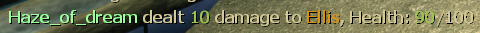

# Friendly Fire Informer

This Left 4 Dead 2 SourceMod plugin reports friendly-fire damage between
survivors in chat. It groups damage dealt by the same attacker to the same
victim during a game frame, then prints the total damage and the victim's
remaining health. If the hit incapacitates the victim, the plugin reports that
the attacker downed them instead. Damage to survivors who are already
incapacitated, self-damage, and damage between players on other teams are
ignored.

## Installation

1. Install MetaMod:Source and SourceMod on your Left 4 Dead 2 server.
2. Copy `friendly_fire_informer.smx` into
   `left4dead2/addons/sourcemod/plugins/`.
3. Restart the server or load the plugin with
   `sm plugins load friendly_fire_informer`.

The plugin has no additional dependencies or configuration requirements.
