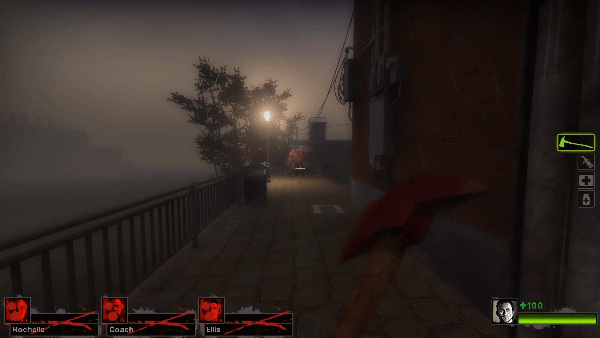

# [L4D2] Parry This

A SourceMod plugin for Left 4 Dead 2 that lets survivors reflect incoming Tank
rocks by hitting them with a melee weapon. Reflected rocks fly back toward
infected and deal configurable damage on impact. They pass through survivors
without causing friendly fire.

## Requirements

- MetaMod:Source and SourceMod on the Left 4 Dead 2 server.
- The SourceMod SDKHooks extension.
- [Left 4 DHooks Direct](https://forums.alliedmods.net/showthread.php?t=321696).

## ConVars

The plugin creates its configuration at
`left4dead2/cfg/sourcemod/parrythis.cfg` when it first loads.

| ConVar | Default | Allowed range | Description |
|---|---:|---:|---|
| `parrythis_enable` | `1` | `0` or `1` | Enables or disables Tank rock reflecting. |
| `parrythis_damage` | `15000.0` | `0.0` or higher | Damage a reflected rock deals to infected it hits. |
| `parrythis_hitbox` | `80.0` | `1.0` or higher | Radius, in units, around a reflected rock used to detect infected hits. |
| `parrythis_noshake` | `1` | `0` or `1` | Blocks screen shake for a short time after a player reflects a rock. |
| `parrythis_debug` | `0` | `0` or `1` | Prints reflection debug information to the reflecting player's chat. |

## Installation

1. Install the requirements listed above on your Left 4 Dead 2 server.
2. Copy `parry_this.smx` into
   `left4dead2/addons/sourcemod/plugins/`.
3. Restart the server or load the plugin with
   `sm plugins load parry_this`.
4. Edit `left4dead2/cfg/sourcemod/parrythis.cfg` to change the ConVars. The
   file is created when the plugin first loads.
