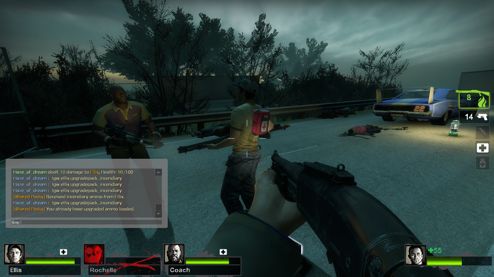

# Shared Packs

This Left 4 Dead 2 SourceMod plugin lets survivors share incendiary or
explosive ammo from their upgrade packs. Aim at another living survivor and
press `E` to apply one use of the pack they're carrying. To use your own pack,
hold `Shift` and `Reload` for the configured hold time. The plugin tracks a
limited number of uses per pack, notifies the pack owner and recipient, and
prevents applying ammo when the recipient already has upgraded ammo loaded.
Explosive ammo cannot be applied to a player holding a grenade launcher.

## ConVars

| ConVar | Default | Description |
| --- | --- | --- |
| `sm_sharepack_enable` | `1` | Enable pack sharing and self-use (`1` = enabled, `0` = disabled). |
| `sm_shared_pack_uses` | `8` | Number of uses before a pack is consumed. Range: `1`-`25`. |
| `sm_shared_packs_hold_time` | `0.5` | Seconds to hold `Shift` and `Reload` to use your own pack. Minimum: `0.1`. |

## Installation

1. Install MetaMod:Source and SourceMod on your Left 4 Dead 2 server.
2. Copy `shared_packs.smx` into
   `left4dead2/addons/sourcemod/plugins/`.
3. Restart the server or load the plugin with
   `sm plugins load shared_packs`.
4. On first load, the plugin creates
   `left4dead2/cfg/sourcemod/shared_packs.cfg`. Edit the ConVars there as
   desired, then reload the plugin or restart the server to apply changes.

The plugin has no additional dependencies.
