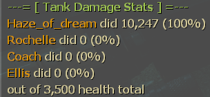

# Tank Damage Stats

This Left 4 Dead 2 SourceMod plugin tracks survivor damage dealt to each Tank
and prints a breakdown in chat when the Tank is killed. Players are listed
from highest to lowest damage, including survivors who dealt no damage. The
plugin attributes actual health lost to survivor attacks, rather than the
reported hit damage, and follows damage when control switches between a human
and a survivor bot.

## ConVars

| ConVar | Default | Description |
| --- | --- | --- |
| `tank_damage_stats_show_percent` | `1` | Show each player's percentage of the total tracked survivor damage (`1` = enabled, `0` = disabled). |

## Installation

1. Install MetaMod:Source and SourceMod on your Left 4 Dead 2 server.
2. Copy `tank_damage_stats.smx` into
   `left4dead2/addons/sourcemod/plugins/`.
3. Restart the server or load the plugin with
   `sm plugins load tank_damage_stats`.
4. On first load, the plugin creates
   `left4dead2/cfg/sourcemod/tank_damage_stats.cfg`. Edit
   `tank_damage_stats_show_percent` if you want to hide damage percentages.

The plugin has no additional dependencies.
